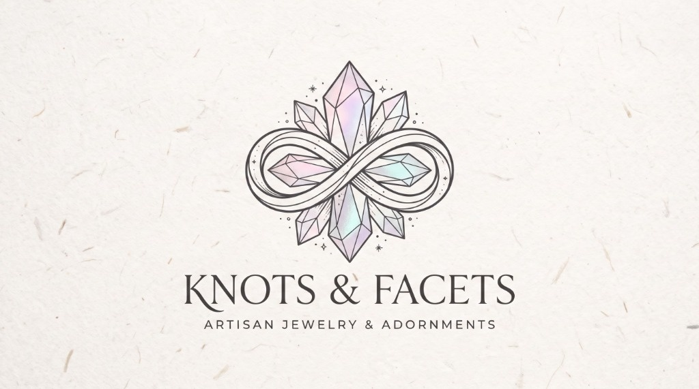
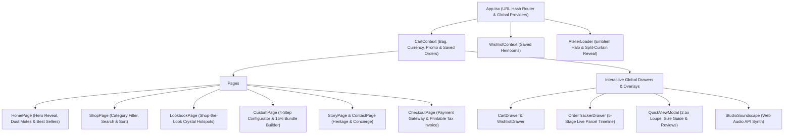
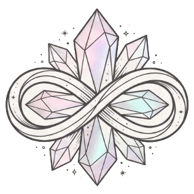

<div align="center">



<br />
<br />

# ✨ KNOTS & FACETS

### *Artisan Jewelry & Adornments — Where Prismatic Light Meets Slow Fibre*

[](https://knots-facets.vercel.app)
[](https://react.dev/)
[](https://www.typescriptlang.org/)
[](https://vitejs.dev/)

<p align="center">
  <strong>Knots &amp; Facets</strong> is a luxury digital flagship and e-commerce atelier for small-batch handcrafted <strong>Bohemian &amp; Czech faceted glass crystal jewellery</strong> and <strong>100% unbleached organic cotton crochet accessories</strong>, crafted slowly in Guwahati, Assam.
</p>

[Explore Live Atelier ↗](https://knots-facets.vercel.app) · [Shop Catalog](https://knots-facets.vercel.app/#shop) · [Lookbook](https://knots-facets.vercel.app/#lookbook) · [Bespoke Configurator](https://knots-facets.vercel.app/#custom)

</div>

---

## 🌿 Atelier Philosophy & Aesthetic Direction

> *"Glass and crystal pieces for the light; crochet accessories for the touch. Every item is made by hand on our raw wooden workbench, so no two are ever alike."*

| Design Pillar | Implementation |
| :--- | :--- |
| **Typography** | Editorial pairing of *Cormorant Garamond* (italic & roman serifs) with *DM Sans* geometric precision |
| **Color Palette** | Warm Unbleached Linen (`#F8F5F0`), Alabaster Surface (`#FFFCF8`), Espresso Ink (`#29231F`), Terracotta Rose (`#9B7765`), & Antique Gold (`#C29B38`) |
| **Sensory Craft** | Web Audio API harmonic soundscape, interactive pointer-tracked color-reveal lens, and floating sunlight dust motes |

---

## 💎 Signature Interactive Features

### 1. 🔮 Bespoke Atelier Preloader & Split-Curtain Reveal
- Features the official **Knots & Facets** crystal-and-infinity-knot emblem surrounded by a rotating astrolabe stitch dial and an iridescent SVG progress halo.
- Cycles through live studio preparation steps (*"Spooling unbleached organic cotton..."* → *"Hand-cutting iridescent crystal facets..."*) before parting twin linen curtains into the hero stage.

### 2. ☀️ Interactive Hero Stage & Live Workbench Telemetry
- **Dual-Layer Pointer Color Reveal**: Hovering across the hero photograph dynamically reveals full-color prismatic refractions through a smooth spring-physics radial mask.
- **Sunlight Dust Motes Canvas**: 60fps HTML5 `<canvas>` particle engine simulating warm morning studio dust motes.
- **Live Workbench Status Badge & Broadcast Ticker**: Real-time studio telemetry showing the piece currently on the artisan bench with 1-click macro inspection.

### 3. 🛍️ Complete Commerce Engine & Multi-Currency Support
- **Live Currency Switcher**: Instant real-time conversion across **USD (`$`)**, **INR (`₹`)**, **EUR (`€`)**, and **GBP (`£`)** persisted in `localStorage`.
- **Macro Loupe Quick-View Modal**: 2.5× optical zoom lens for inspecting crystal facets and crochet stitch tension, complete with **Provenance**, **Size & Fit Guide**, and **Verified Collector Reviews (`4.9 ★`)** tabs.
- **Saved Heirlooms Wishlist & Shopping Bag Drawers**: Includes a live progress bar toward the **$80 Complimentary Wax-Sealed Keepsake Gift Box** threshold.

### 4. 🎨 Bespoke 4-Step Commission Configurator & 15% Keepsake Box Builder
- **01. Bespoke Commission Configurator**: Customize creation type (*Bridal Suite, Tailored Crochet Tote, Prismatic Suncatcher, Keepsake Suite*), color harmony swatches, and metal finish (*14k Gold-Filled, 925 Sterling Silver, Antique Brass*) with a **Sticky Live Atelier Preview** that adds directly to the bag.
- **02. Interactive Keepsake Gift Box Builder**: Pair *1 Glass & Crystal Jewellery Piece* + *1 Slow-Stitched Crochet Creation* + *1 Wax Seal Impression Color* (*Antique Gold, Rosewood Crimson, Botanical Sage*) to unlock an automatic **15% Duet Savings**.

### 5. 📸 Interactive "Shop the Look" Editorial Lookbook
- Filterable masonry gallery (*Prismatic Sunlight*, *Fibre & Cotton*, *Atelier & Craft*, *Keepsake Unboxing*) featuring glowing **crystal hotspot pins** on every photograph for 1-click inspection and bag additions.

### 6. 🔒 Full-Page Checkout, Multi-Method Payment Gateway & Archival Tax Invoice
- **Multi-Mode Payment Gateway**:
  - **Credit / Debit Card**: Interactive live visual card preview with automatic brand detection (`VISA`, `MASTERCARD`, `AMEX`, `RUPAY`), formatted card number, expiry, CVV, and a 1-click **Auto-Fill Test Details** mode.
  - **Instant UPI / Dynamic QR**: App selector (`Google Pay`, `PhonePe`, `Paytm`, `BHIM`), VPA verification, and a scannable vector QR code.
  - **Express Wallets & Pay-in-4**: Automatic `Klarna / Simpl` 4× interest-free installment calculator (`0% APR`), `PayPal Express`, and `Apple Pay`.
  - **Pay on Delivery (COD)**: Verified doorstep settlement option.
- **Working Promo Code Engine**: Supports `KNOTS10` (*10% off*), `ATELIER15` (*15% off*), and `FREESHIP` (*Complimentary Express Air Courier*).
- **Printable Archival Tax Invoice & Certificate of Provenance**: Generates a museum-grade invoice with double-border ornaments, emblem watermark, HSN/craft codes, vector barcode, Master Artisan signature, authentic wax seal stamp, and a dedicated `@media print` single-page PDF stylesheet.
- **5-Stage Live Order Tracker Drawer**: Persists completed orders in `localStorage` (`kf_orders`) and tracks parcels from *Order Reserved* through *Crystal Faceting & Slow Crochet Stitching* to *Dispatched from Guwahati*.

### 7. 🎵 Generative Web Audio Studio Soundscape
- Built-in Web Audio API synthesizer (`StudioSoundscape.tsx`) generating a warm `432Hz`-tuned ambient harmonic drone and randomized Solfeggio crystal chimes—zero external MP3 files required.

---

## 🏗️ System Architecture



---

## 📂 Project Structure

```text
Knots-Facets/
├── public/
│   └── images/                  # High-resolution studio photography & transparent brand emblems
│       ├── logo-mark.png        # Official crystal & infinity-knot emblem (transparent PNG)
│       ├── logo-full.png        # Full lockup with typography (transparent PNG)
│       ├── logo.jpg             # Textured archival paper brand banner
│       └── ...                  # Product & lookbook photography
├── src/
│   ├── components/
│   │   ├── AtelierLoader.tsx          # Split-curtain preloader with iridescent progress ring
│   │   ├── CartDrawer.tsx             # Slide-out shopping bag with $80 free gift progress bar
│   │   ├── Footer.tsx                 # Editorial footer & newsletter subscription
│   │   ├── LightRefractionOverlay.tsx # Ambient crystal caustic light overlay
│   │   ├── LiveAtelierTicker.tsx      # Studio broadcast marquee ribbon
│   │   ├── LiveWorkbenchBadge.tsx     # Floating hero workbench telemetry card
│   │   ├── MobileQuickPurchaseBar.tsx # Sticky mobile 1-tap purchase bar
│   │   ├── Navbar.tsx                 # Glassmorphic header with Soundscape, Tracker, Wishlist & Bag
│   │   ├── OrderTrackerDrawer.tsx     # 5-stage studio crafting & courier tracking drawer
│   │   ├── ProductCard.tsx            # Interactive product card with quick actions
│   │   ├── QuickViewModal.tsx         # 2.5x macro zoom lens + Provenance, Size & Reviews tabs
│   │   ├── SidebarDrawer.tsx          # Mobile & tablet navigation drawer
│   │   ├── StudioSoundscape.tsx       # Web Audio API harmonic drone & crystal chime synth
│   │   ├── ToastContainer.tsx         # Non-intrusive studio notification toasts
│   │   └── WishlistDrawer.tsx         # Saved heirlooms drawer with 1-click Move-to-Bag
│   ├── context/
│   │   ├── CartContext.tsx            # Global cart, multi-currency, custom items & order persistence
│   │   └── WishlistContext.tsx        # Global wishlist state persisted in localStorage
│   ├── data/
│   │   └── catalog.ts                 # Curated 10-piece catalog, currencies & lookbook items
│   ├── hooks/
│   │   └── usePageAnimations.ts       # Scroll-triggered reveal observer
│   ├── pages/
│   │   ├── CheckoutPage.tsx           # Full checkout, 4-mode payment gateway & printable tax invoice
│   │   ├── ContactPage.tsx            # Guwahati studio concierge & care FAQ
│   │   ├── CustomPage.tsx             # 4-step bespoke configurator & 15% keepsake bundle builder
│   │   ├── HomePage.tsx               # Hero stage, curated best sellers, collections & reviews
│   │   ├── LookbookPage.tsx           # Masonry editorial gallery with Shop-the-Look hotspots
│   │   ├── ShopPage.tsx               # Filterable & searchable complete catalog
│   │   └── StoryPage.tsx              # Dual-craft manifesto & artisan lineage
│   ├── App.tsx                        # Root application & URL hash router
│   ├── index.css                      # Master bespoke luxury stylesheet & @media print rules
│   ├── main.tsx                       # React 18 DOM entry point
│   └── types.ts                       # TypeScript interfaces & domain models
├── index.html
├── package.json
├── tsconfig.json
└── vite.config.ts
```

---

## 🚀 Getting Started Locally

### Prerequisites
- **Node.js** `>= 18.x` and **npm** `>= 9.x`

### 1. Clone the Repository
```bash
git clone git@github.com:HimonBhuyan/Knots-Facets.git
cd Knots-Facets
```

### 2. Install Dependencies
```bash
npm install
```

### 3. Start the Development Server
```bash
npm run dev
```
Open `http://localhost:5173` in your browser.

### 4. Production Build & Type-Check
```bash
npm run build
npm run preview
```

---

## 🧪 Quick Testing Guide (Checkout & Promo Codes)

1. **Test Promo Codes at Checkout**:
   - `KNOTS10` — **10% OFF** entire order
   - `ATELIER15` — **15% OFF** VIP Collector Discount
   - `FREESHIP` — **Complimentary Priority Express Air Courier**
2. **1-Click Payment Gateway Demo**:
   - On the Checkout page (`/#checkout`), click **"Auto-Fill Test Details"** at the top to automatically populate collector shipping details and a test Visa card (`4532 8910 4421 8894`), then click **"Pay Securely"** to experience the 256-Bit SSL gateway handshake and generate a printable **Archival Tax Invoice & Certificate of Provenance**.

---

<div align="center">
  
  <p>
    <strong>KNOTS &amp; FACETS ATELIER</strong><br />
    <em>Handcrafted with love &amp; detail in Guwahati, Assam</em>
  </p>
</div>
